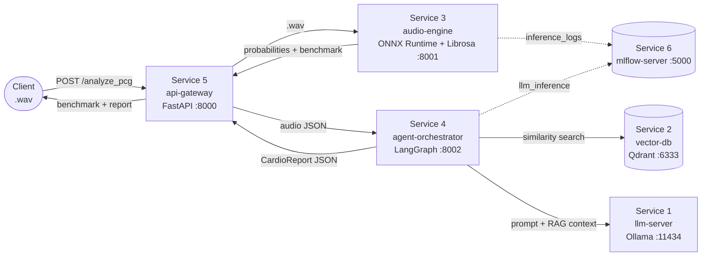

# CardioAgent-Ops

**Containerized micro-service platform (Docker), MLOps, LLM fine-tuning, RAG and multi-agent AI for heart-sound
(PCG) analysis** — mini-project *Data Mining & Machine Learning*, ENSIT, section 3G Math, 2026-2027
(teacher: Dr. Mehrez Boulares). Team: **Farah Belghith** and **Zaineb** (`zaineb1802`); how the two works were merged:
[`MERGE_NOTES.md`](MERGE_NOTES.md).

A `.wav` heart sound goes in; out comes (1) the answer of 5 machine-learning models + an ensemble, run with ONNX
Runtime, and (2) a careful French report written by 3 AI agents (Analyste → Cardiologue RAG → Auditeur), grounded on
cardiology documents and checked by Pydantic. Everything runs locally in 6 Docker containers: no data leaves the PC.

## 1. Architecture: the 6 micro-services



| # | Service | Image (Dockerfile in `docker/`) | Role |
|---|---|---|---|
| 1 | `llm-server` | `ollama/ollama:0.40.18` (`llm-server.Dockerfile`) | the local LLM (GGUF 4-bit): base `qwen2.5:3b-instruct`, or `cardio-llm` (our QLoRA fine-tune) |
| 2 | `vector-db` | `qdrant/qdrant:v1.20.2` (`vector-db.Dockerfile`) | embeddings of the RAG documents, cosine search |
| 3 | `audio-engine` | Python 3.12 multi-stage (`audio-engine.Dockerfile`) | preprocessing (2000 Hz, 5 s, Mel, MFCC), the 5 ONNX models + ensemble, MLflow inference logs |
| 4 | `agent-orchestrator` | Python 3.12 multi-stage (`agent-orchestrator.Dockerfile`) | LangGraph graph of the 3 agents, RAG, Pydantic guardrails, MLflow LLM metrics |
| 5 | `api-gateway` | Python 3.12 multi-stage (`api-gateway.Dockerfile`) | the only entry point: `/analyze_pcg` + the web page |
| 6 | `mlflow-server` | `ghcr.io/mlflow/mlflow:v2.22.4` (`mlflow-server.Dockerfile`) | experiment tracking, Model Registry, inference traceability |

## 2. How to run

Prerequisites: Docker Desktop (WSL2), and for the notebooks Python 3.10 (`venv`, packages of the notebooks).

```powershell
docker volume create mlflow-data           # once (it already exists on Farah's PC: all the MLflow runs are in it)
docker compose up --build -d               # the 6 services (the first start downloads the LLM, ~2 GB)
docker compose ps                          # all "healthy"
docker compose run --rm agent-orchestrator python -m rag_engine.ingest      # index the RAG documents (once)
```

Then open **http://localhost:8000** (drop a `.wav`), MLflow on **http://localhost:5000**. A check with real wavs of
the test set: `venv\Scripts\python scripts\check_platform.py` (audio engine) or `... 1 --agents` (whole pipeline).
Settings: a `.env` file next to `docker-compose.yml`, e.g. `LLM_MODEL=cardio-llm` once the fine-tuned GGUF is in
`llm_server/models/`. Retrain all the models: `venv\Scripts\python audio_engine\train_all.py`.


## 3. Data — `notebooks/01_eda_data_wrangling.ipynb`

- **Fusion**: PhysioNet/CinC 2016 (training-a…f, `REFERENCE.csv`: −1 normal, 1 abnormal) + PASCAL Heart Sound
  Challenge (set A and B: `normal` → normal, `murmur` + `extrastole` → abnormal) → `ourdataset/train/normal|abnormal`:
  **3766 wavs** (2926 normal, 840 abnormal).
- **EDA**: durations (0.8 to 122 s), signal-to-noise ratio (TP1 formula), FFT, spectrogram, Mel spectrogram, KDE,
  zero-crossing rate.
- **Cleaning** (the same rules in every notebook and in the audio engine): too short (< 2 s), silent (peak < 0.001),
  saturated (> 1 % of the samples at |x| ≥ 0.99) → **85 removed, 3681 kept (2855 normal, 826 abnormal)**.
- **Harmonisation**: every wav at **2000 Hz**, the middle **5 s** (shorter wavs repeated); features: MFCC (mean + std),
  Mel spectrograms (40 × 157 images in dB for the CNNs, 30 bands flattened for the SVM study), Zaineb's 72 summary
  features (duration, SNR, Mel bands, MFCC, spectral centroid, ZCR) on the whole wav; `class_weight="balanced"`
  (normal 0.645, abnormal 2.23) for the imbalance.
- **Fixed test set**: 20 % of the clean wavs, stratified, `random_state=42` → `splits/test_files.json` (737 wavs, 165
  abnormal). Never used to train or to choose anything. The 3 validation folds (`KFold(3, shuffle=True,
  random_state=1)`) cut the 80 % train part (2944 wavs). Limitation shown in the notebook: only the PASCAL file names
  give the patient; 61 PASCAL patients have wavs on both sides (10.7 % of the wavs have a known patient).

## 4. The 5 models + the ensemble — `notebooks/02` to `08`

**Protocol (the same for every model):** the fixed 20 % **test** set is put aside; the 80 % train part (2944 wavs) is
cut in **3 validation folds**; each fold trains on 2/3 and is evaluated on the other third (**validation**: mean of
the 3 folds); then the final model is trained on the whole 80 % and tested **once** on the 20 % (**test**). Epochs,
depths, C/gamma, the ensemble members… are chosen with the validation folds only. The positive class is
**abnormal**; the selection metric is the **recall** of abnormal (a missed sick heart is the worst mistake), then F1.
Accuracy is shown but is misleading here: 78 % of the wavs are normal.

| Notebook | Model | Input | Final settings |
|---|---|---|---|
| `03_Tp4_decision_tree` | Decision tree (model 1) | Zaineb's 72 summary features | entropy, max_depth 7 (chosen in the folds, recall rule), balanced |
| `02_Tp3_svm` | SVM rbf (model 2) | the same 72 features, standardized | C = 1, gamma "scale" (F2 search in the folds kept the default), balanced; + Farah's study of the Mel features (2/5/10 s, linear vs rbf) |
| `04_Tp7_cnn` | Custom CNN (model 3) | Mel spectrogram 40 × 157 (5 s) | 3 × (Conv2D 16/32/64 + MaxPooling), Flatten, Dense 32, Dropout 0.5, sigmoid; 20 epochs, Adam, balanced |
| `06_Tp8_transfer_learning` | ResNet50 transfer learning (model 4) | magma image of the spectrogram → 224 × 224 | frozen ImageNet ResNet50 (2048 features) + BatchNorm, Dense 256, Dropout 0.5; early stopping on 10 % of the training wavs (max 60 epochs); VGG16 the same way, kept in MLflow to compare |
| `07_transformer_cnn` | Transformer-CNN hybrid (model 5) | Mel spectrogram 40 × 157 | 2 × (Conv2D + BatchNorm + MaxPooling) → 39 time tokens of 64 numbers + sinusoidal positions → 2 encoder blocks (4-head self-attention, Add & Norm, FFN) → average → sigmoid; 15 epochs |
| `08_ensemble` | Soft vote (6th line of the benchmark) | the probabilities of the models | mean of CNN + ResNet50 + Transformer-CNN + decision tree, chosen on the out-of-fold validation probabilities |

How each notebook became the best of Farah's and Zaineb's work: [`MERGE_NOTES.md`](MERGE_NOTES.md) (all candidates,
same folds, same rule).

### Benchmark (audio engine order = mean validation recall)

| Model | Val. recall | Val. F1 | Val. precision | Val. accuracy | Val. AUC | **Test recall** | Test F1 | Test precision | Test accuracy | Test AUC |
|---|---|---|---|---|---|---|---|---|---|---|
| **CNN** (official answer, `cardio_model.onnx`) | **0.938** | 0.628 | 0.472 | 0.750 | 0.905 | 0.909 | 0.661 | 0.519 | 0.791 | 0.932 |
| SVM rbf (72 features) | 0.894 | 0.705 | 0.582 | 0.832 | 0.931 | 0.915 | 0.728 | 0.604 | 0.847 | 0.944 |
| Ensemble (soft vote of 4) | 0.858 | 0.714 | 0.619 | 0.843 | 0.941 | **0.933** | 0.726 | 0.595 | 0.843 | 0.954 |
| Decision tree (72 features) | 0.820 | 0.657 | 0.550 | 0.807 | 0.864 | 0.927 | 0.643 | 0.492 | 0.769 | 0.891 |
| Transformer-CNN | 0.815 | 0.658 | 0.598 | 0.809 | 0.927 | 0.861 | 0.684 | 0.568 | 0.822 | 0.933 |
| ResNet50 transfer learning | 0.793 | **0.746** | **0.704** | **0.879** | **0.942** | 0.812 | **0.764** | **0.720** | **0.887** | **0.955** |
| *VGG16 (MLflow only)* | 0.784 | 0.721 | 0.669 | 0.864 | 0.927 | 0.764 | 0.716 | 0.674 | 0.864 | 0.936 |


**Reading the table.** The CNN is the official answer because the PDF asks for the model that maximizes the recall:
on validation it finds 94 % of the sick hearts, but almost 1 alarm in 2 is false (precision 0.47). ResNet50 is the
most balanced model (best F1, precision and AUC) but misses 1 sick heart in 5. The ensemble is the compromise: on the
test set it finds 93 % of the sick hearts with a precision of 0.60. The test results are close to the validation
results (no sign of over-fitting to the folds); they are a little higher for recall, which is normal variation for
165 abnormal test wavs (1 wav = 0.6 % of recall).

Each notebook saves, for every model: the confusion matrix + ROC of **each validation fold**, a summary of the 3
folds, the **test** confusion matrix + ROC + `classification_report` (`models plots/*_val_fold*.png`,
`*_val_summary.png`, `*_test.png`, `*_test_report.txt`), the training / validation curves (learning curves for the
SVM and the tree, loss/accuracy per epoch for the networks).

## 5. MLflow, ONNX and the audio engine — Services 3 and 6

- **MLflow** (`http://localhost:5000`, volume `mlflow-data`): experiment `audio_benchmark_final` — 1 main run per
  model (params, mean validation metrics `mean_*`, test metrics `test_*`, the model, the plots in
  `plots/validation` and `plots/test`) with **1 nested run per fold** (`val_*` metrics, and the training curves per
  epoch: tab "Model metrics"). Runs of older versions of a notebook are kept with the tag `superseded` (never deleted);
  the first experiment `audio_benchmark` is kept as history.
- **`05_best_model_onnx.ipynb`**: reads the best run of each model in MLflow (validation recall, then F1), draws the
  benchmark, exports the 5 models to **ONNX** (skl2onnx for the tree and the SVM, tf2onnx for the networks; for
  ResNet50 the resize to 224 × 224 and `preprocess_input` are put inside the ONNX graph) and checks on 20 test wavs
  that ONNX Runtime gives the same decision (max probability difference ≤ 2.2e-6). The best model is copied as
  `audio_engine/cardio_model.onnx` and registered in the **Model Registry** as `cardio_model` with the alias
  `champion` (version 5 = the CNN). `audio_engine/benchmark.json` = the 6 lines of the table above.
- **Audio engine** (`audio_engine/main.py`, FastAPI): `POST /predict` (a `.wav`) → resampling at 2000 Hz, the same
  quality rules as the notebooks (silent → 400; too short / saturated → a warning), the features of each model (same
  code as the notebooks), the 5 ONNX models + the ensemble (mean of the members' outputs) → `prediction`,
  `probability_abnormal`, `model` (the official CNN) and `benchmark` (the answer and the scores of every model).
  `GET /benchmark`, `GET /health`. After each answer, a background task writes a small run in the MLflow experiment
  **`inference_logs`** (model, prediction, probability, latency, duration; never the file name or the audio). The
  models are warmed up when the container starts. Retrain everything: `venv\Scripts\python audio_engine\train_all.py`
  (02, 03, 04, 06, 07, 08, then 05).

## 6. LLM fine-tuning (QLoRA) — `llm_finetuning/`

| Item | Value |
|---|---|
| Dataset | `cardio_instructions.jsonl`: 506 French instruction examples made by `build_dataset.py` (fixed seed, no patient data): explaining an audio-engine result (text, or the JSON report of the agents), heart-sound basics from the course of `article for rag/` (B1, B2, foyers, souffles, B3/B4…), when to see a doctor, safety (no diagnosis, no prescription, emergencies, personal data) |
| Base model | `unsloth/Qwen2.5-7B-Instruct-bnb-4bit` (Qwen 2.5 7B Instruct in 4-bit) |
| Method | QLoRA with Unsloth + TRL `SFTTrainer`: LoRA r = 16, alpha = 16 on q, k, v, o, gate, up, down; lr 2e-4, batch 2 × gradient accumulation 4, 1 epoch, max_seq_length 1024, loss on the answers only |
| Where | Google Colab, free T4 GPU (`train_qlora_colab.ipynb`): my PC has no GPU usable by TensorFlow/PyTorch |
| Outputs | `trainer_state.json` (the loss of each step) → `log_finetuning_to_mlflow.py` → MLflow experiment `llm_finetuning` (loss curve, params, peak VRAM) + registry `cardio_llm` (the LoRA adapter); the GGUF `q4_k_m` export (~4.7 GB) → `llm_server/models/` → `ollama create cardio-llm` (`Modelfile`: Qwen ChatML template, French system prompt, temperature 0.2, num_ctx 4096) |

**Results** (Colab, Tesla T4, saved in `llm_finetuning/outputs/`: `trainer_state.json`, `run_info.json`):

| Result | Value |
|---|---|
| Training | 63 steps = 1 epoch of the 506 examples (batch 2 × accumulation 4), **7.4 min** |
| Training loss | **2.17** (step 1) → **0.15** (step 63); mean 0.55; mean of the last 10 steps 0.19 |
| Peak GPU memory (VRAM) | **13.4 GB** of the 15 GB of the T4 (7B model in 4-bit + LoRA adapters + activations) |
| Exported files | LoRA adapter (`cardio_lora_adapter.zip`, 145 MB) and `cardio-qwen2.5-7b-q4_k_m.gguf` (4.4 GB), in Google Drive `MyDrive/cardioagent_llm/` |

To use it: download the 2 files, unzip the adapter in `llm_finetuning/outputs/cardio_lora_adapter/`, put the GGUF in
`llm_server/models/`, run `venv\Scripts\python llm_finetuning\log_finetuning_to_mlflow.py` (MLflow experiment
`llm_finetuning`: loss curve, params, VRAM, GGUF SHA256 + registry `cardio_llm`), then `LLM_MODEL=cardio-llm` in
`.env` and `docker compose up -d` (the llm-server runs `ollama create cardio-llm` with the Modelfile).

## 7. RAG — `rag_engine/` + Service 2 (Qdrant)

- **Documents** (`article for rag/`, full list with authors, URLs and licenses in
  [`article for rag/SOURCES.md`](article%20for%20rag/SOURCES.md)): 4 "clinique" documents (2 French courses on normal
  and pathological auscultation, the UMVF cardiac semiology course, the French summary of the ESC 2022
  recommendations — HAL hal-04166622, CC BY-NC) and 13 "technique" papers (the PhysioNet/CinC 2016 challenge and 12
  of its entries).
- **Why not the 2025 ESC/EACTS valvular guidelines?** The ESC states that its guidelines may not be used in software
  tools or generative AI without a licence agreement, so the PDF is not indexed; the ESC content comes from the HAL
  summary (open license). The ingest knows the file name (`ehaf194.pdf`) if a licensed copy is added later.
- **Indexing** (`ingest.py`): pypdf text → cleaning (repeated headers/footers, page numbers, copyright lines,
  hyphenation) → chunks of ~800 characters with 150 in common → embeddings `paraphrase-multilingual-MiniLM-L12-v2`
  (fastembed, ONNX, French + English, 384 numbers) → Qdrant collection `cardio_guidelines` (cosine), payload
  `source`, `title`, `page`, `category`. **17 documents → 509 chunks.**
- **Search** (`search.py`): `search(question, k=4, category=None)` with a Qdrant filter on the category (the
  Cardiologue agent uses `clinique`, the Analyste `technique`).
- **Evaluation** (`evaluate_rag.py` → `rag_engine/rag_evaluation.json`): 18 French questions with the documents that
  hold the answer.

| Questions | hit@1 | hit@3 | hit@5 | MRR | keyword hit |
|---|---|---|---|---|---|
| all (18) | 0.722 | 0.944 | 0.944 | 0.815 | 0.889 |
| clinique (12) | 0.917 | 1.000 | 1.000 | 0.958 | 0.917 |
| technique (6, French questions on English papers) | 0.333 | 0.833 | 0.833 | 0.528 | 0.833 |

## 8. The 3 agents — `agents/` + Service 4

- **Graph** (`graph.py`, LangGraph `StateGraph`): **Analyste** (reads the audio result: prediction, probability,
  agreement of the models, warnings; writes a short analysis and the RAG query) → **Cardiologue RAG** (searches the
  clinical documents and explains the result using only these passages, with citations `[n]`) → **Auditeur**
  (rules + the LLM: Pydantic schema, coherent with the audio prediction, no definitive diagnosis, no prescription,
  sources cited, a disclaimer that sends to a doctor). Not approved → **one retry** of the Cardiologue with the issues,
  then a **safe fallback report** written by the code. LLM down → the fallback report too.
- **Schemas** (`schemas.py`, Pydantic v2): `AudioResult` (the audio-engine JSON, checked at the entry of
  `/orchestrate`) and `CardioReport`: `prediction` (`normal`/`abnormal`), `probability_abnormal`, `model`,
  `risk_level` (`faible` < 0.3 ≤ `modéré` < 0.7 ≤ `élevé`), `summary`, `clinical_explanation`, `recommendations`
  (≥ 1), `sources` (title + page), `disclaimer` (must mention a doctor), `audit` (approved, issues). The fields that
  come from the audio result are filled by the code, never by the LLM.
- **Guardrails "sans fuite de données"**: Ollama and Qdrant run in the Docker network (no external API), the audio
  never goes to the LLM (only the numbers of the audio engine), the file name is removed, nothing about the patient is
  stored. MLflow experiment `llm_inference`: latency of each agent and total, prompt/eval tokens, schema_valid,
  approved, retries, fallback.
- `llm.py`: a thin wrapper of Ollama's `/api/chat` (`format: "json"`, temperature 0.2) → the tests replace it by a fake.
  `prompts.py`: the 3 system prompts in French.

## 9. Tests, coverage, CI/CD

- `tests/test_audio.py` (signal transformations, features of each model, quality rules, `/predict`, MLflow logging
  never breaks a prediction), `tests/test_api.py` (gateway: 400, 503, forwarding, degraded mode when the agents are
  down), `tests/test_agents.py` (Pydantic valid/invalid, the Auditeur's rules, the graph with a fake LLM: happy path,
  retry, fallback, LLM down, no file name sent to the LLM), `tests/test_rag.py` (cleaning, chunking, ingest and search
  with a fake Qdrant, evaluation metrics). Wavs are generated in the tests (numpy + soundfile); every service is mocked.
- `pip install -r requirements-test.txt` (no TensorFlow), then
  `pytest --cov=audio_engine --cov=api --cov=agents --cov=rag_engine --cov-report=term-missing`.

Result on Farah's PC: **70 tests passed, total coverage 90 %** (`agents/graph.py` 90 %, `api/main.py` 96 %,
`audio_engine/main.py` 90 %, `rag_engine/ingest.py` 94 %, `agents/schemas.py` 100 %).

- **GitHub Actions** (`.github/workflows/mlops-ci-cd.yml`), at each push and pull request: job `tests` (Python 3.10,
  pytest + coverage, fails under 70 %, `coverage.xml` kept as an artifact), then job `build` (Docker images of the API
  gateway and the audio engine, started and checked on `/health`).

## 10. Resources and speed (measured on Farah's PC)

PC: Intel Core i7-8750H (6 cores / 12 threads), 16 GB of RAM, an HDD + a small SSD, NVIDIA GTX 1060 (not usable by
TensorFlow on Windows nor by Ollama in Docker with this driver). Docker Desktop (WSL2) gets 12 threads and 7.7 GiB.

`docker stats --no-stream` with the 6 services running (llm-server = `qwen2.5:3b-instruct` loaded):

| Container | CPU | Memory |
|---|---|---|
| llm-server | 403.34% | 1.665GiB / 7.676GiB |
| api-gateway | 0.26% | 44.58MiB / 7.676GiB |
| agent-orchestrator | 0.26% | 761.4MiB / 7.676GiB |
| audio-engine | 0.31% | 543.3MiB / 7.676GiB |
| mlflow-server | 0.01% | 700.4MiB / 7.676GiB |
| vector-db | 0.34% | 229.2MiB / 7.676GiB |

| Step | Time / memory |
|---|---|
| Audio engine, `POST /predict` (real 35 s test wav, 5 ONNX models + ensemble) | **0.9 s** |
| Audio engine start (load the models + warm-up) | 1–4 min (healthcheck `start_period` 180 s) |
| ONNX files | CNN 0.5 MB, SVM 0.4 MB, tree 4 KB, Transformer-CNN 0.4 MB, ResNet50 92 MB |
| LLM 3B (GGUF q4_k_m, 1.9 GB file) | ~1.7 GB of RAM once loaded; kept in memory (`OLLAMA_KEEP_ALIVE=-1`) |
| QLoRA fine-tuning (Colab T4) | 13.4 GB of VRAM, 7.4 min |
| Fine-tuned 7B (GGUF q4_k_m) | 4.4 GB file, ~5 GB of RAM |

**Bottleneck found on this PC:** with 16 GB of RAM, the browser and the notebooks, Windows pushes part of the Docker
VM's memory into the page file on the hard disk; then everything inside Docker becomes very slow (the first load of
the LLM took ~20 min, the first MLflow start ~4 min). Fixes in the compose file: the LLM is loaded **once** at start
and kept in memory, its load timeout is 30 min, the MLflow healthcheck waits up to 5 min, and the gateway waits up to
15 min for a report (and still returns the audio result if the agents fail). On a PC with more free RAM (or a GPU),
the same files run much faster.

## 11. Limits (honest notes)

- **Data**: 2 public datasets, 3681 wavs; the folds are not grouped by patient (only the PASCAL file names give the
  patient, 10.7 % of the wavs); the test set comes from the same sources, so the results are optimistic for a new
  stethoscope or hospital.
- **The official CNN** has a very high recall but a low precision (about 1 alarm in 2 is false on validation): good
  for screening, not for deciding. The benchmark of every answer shows the other models; the ensemble is the
  balanced choice.
- **LLM on CPU**: no usable GPU in Docker on this PC, so the default LLM is the 3B model; a report takes minutes.
  The fine-tuned 7B model works the same way (`LLM_MODEL=cardio-llm`) but is slower and needs ~5 GB more RAM.
- **Fine-tuning**: the instruction dataset is generated from templates (fixed seed, no patient data); only the
  training loss is measured (no held-out evaluation), so the low final loss also shows that the templates repeat.
- **RAG**: the technical questions are in French and the papers in English: hit@1 is only 0.33 for them (0.92 for
  the clinical questions).
- **Not a medical device**: every report says so and sends to a doctor.

## 12. Repository map

| Path | What |
|---|---|
| `notebooks/01`–`09` | EDA + cleaning + test split, the 5 models, the ensemble, ONNX/benchmark, the merge proof |
| `models plots/` | every figure and report of the notebooks (validation folds, summaries, test, curves, benchmark) |
| `splits/test_files.json` | the fixed 20 % test set (file names + labels) |
| `audio_engine/` | Service 3: `main.py`, the ONNX models, `benchmark.json`, `train_all.py` |
| `api/` | Service 5: `main.py` (gateway) + `index.html` (the web page) |
| `agents/` | Service 4: LangGraph graph, prompts, Pydantic schemas, Ollama client |
| `rag_engine/` | ingest / search / evaluation of the RAG (Qdrant) |
| `llm_finetuning/` | dataset builder, Colab QLoRA notebook, Modelfile, MLflow logging of the fine-tuning |
| `llm_server/` | where the fine-tuned GGUF goes (git-ignored) |
| `docker/`, `docker-compose.yml` | the 6 Dockerfiles + the compose file |
| `tests/`, `pytest.ini`, `requirements-test.txt`, `.github/workflows/` | tests and CI/CD |
| `scripts/check_platform.py` | smoke test of the running platform with real test wavs |
| `article for rag/SOURCES.md` | the RAG documents: titles, authors, links, licenses (the PDFs added later stay local) |
| `courses/` | the course and TP notebooks of the module (the reference style) |
| `MERGE_NOTES.md`, `CHANGES_FOR_FARAH.md` | the merge with Zaineb; the summary of the changes |

## 13. Team

- **Farah Belghith** — data fusion, EDA, the first version of every model notebook (tree, SVM, CNN, ResNet50 /
  VGG16), MLflow, ONNX, the services and the platform.
- **Zaineb** (`zaineb1802`) — the 72 summary features, cross-validated settings, early stopping and Dense 256 for
  transfer learning, the patient-leakage check, the test and smoke-test ideas (details and credits:
  [`MERGE_NOTES.md`](MERGE_NOTES.md)).

Teacher: Dr. Mehrez Boulares — Data Mining & Machine Learning, ENSIT, 3G Math, 2026-2027.
